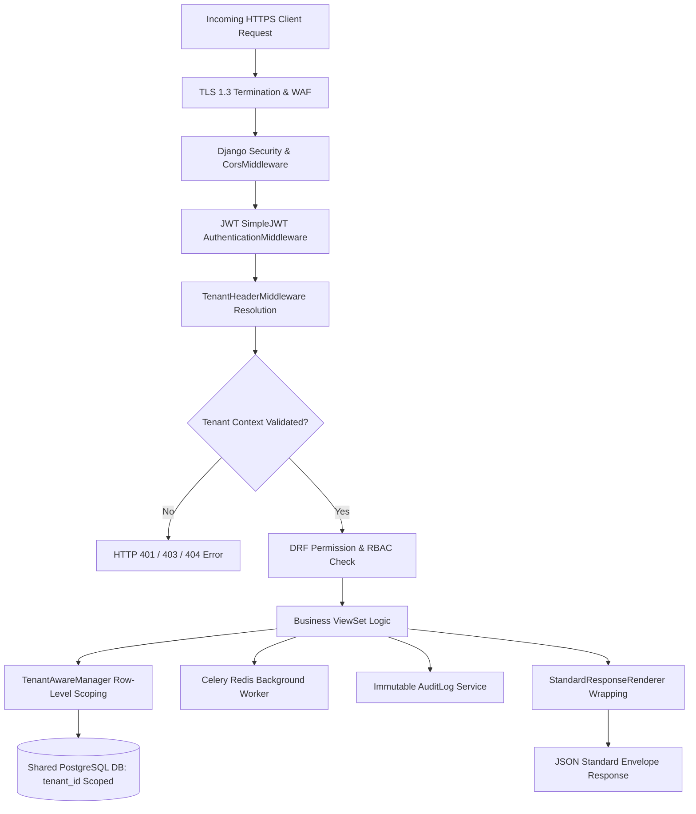
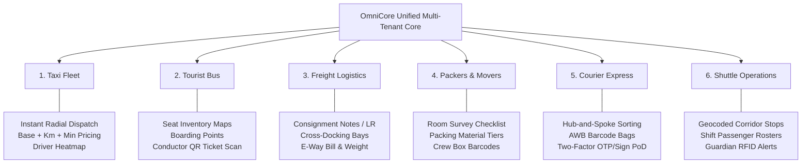
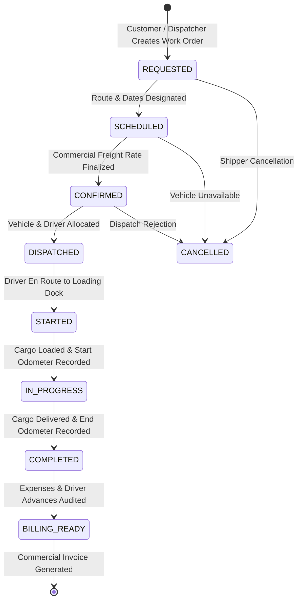
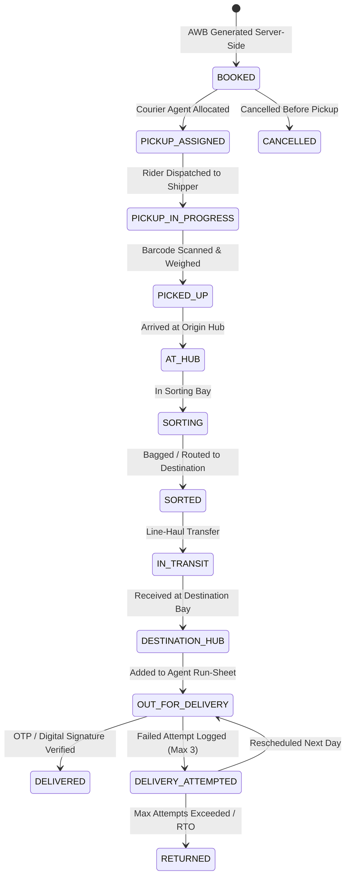
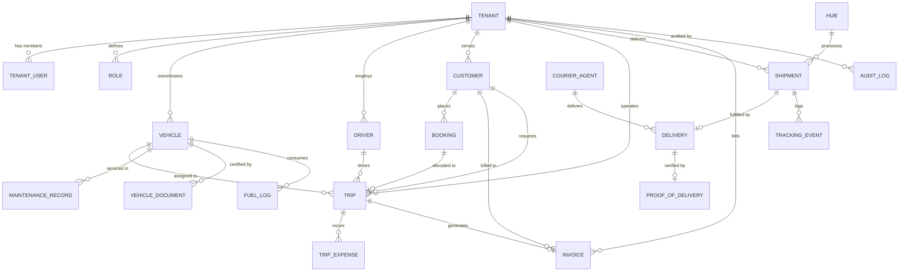

# OmniCore Logistics & Fleet Ecosystem
# Functional Requirements Document (FRD)

**Document Reference:** `OMNICORE-FRD-2026-V1`  
**Platform Version:** 1.0.0 (Enterprise Production Target)  
**Classification:** Confidential & Proprietary — Engineering, Product & Architecture  
**Target Backend:** Django 6.1.1, Django REST Framework 3.18.1, SimpleJWT 5.5.1, Celery 5.4, Redis, PostgreSQL / SQLite  
**Target Clients:** Web (React 19+ / TypeScript), Mobile (Driver/Courier PWA & Native), Public Portals  
**Effective Date:** October 2026  
**Status:** Approved for Implementation & Audit  

---

## Document Control & Revision History

| Version | Date | Author / Role | Summary of Changes | Status |
| :--- | :--- | :--- | :--- | :--- |
| **1.0.0** | October 2026 | Lead Enterprise Architect | Initial Master FRD covering 22 core modules, 6 vertical specializations, RBAC permissions matrix, finite state machines, and non-functional requirements. | Approved |

### Stakeholder Approvals

| Stakeholder Role | Name / Title | Signature / Approval Date |
| :--- | :--- | :--- |
| **Chief Technology Officer** | Architecture Review Board | October 2026 — Approved |
| **Head of Product Management** | SaaS Platform Operations | October 2026 — Approved |
| **Director of Information Security** | Security & Compliance Group | October 2026 — Approved |
| **VP of Engineering** | Core Systems Delivery | October 2026 — Approved |

---

## Table of Contents

- [1. Executive Summary & Product Vision](#1-executive-summary--product-vision)
- [2. Problem Statement & Business Objectives](#2-problem-statement--business-objectives)
- [3. Scope of the System](#3-scope-of-the-system)
  - [3.1 In-Scope Capabilities](#31-in-scope-capabilities)
  - [3.2 Out-of-Scope Capabilities](#32-out-of-scope-capabilities)
- [4. User Personas & Role-Based Access Control (RBAC)](#4-user-personas--role-based-access-control-rbac)
  - [4.1 Global Platform Personas](#41-global-platform-personas)
  - [4.2 Tenant-Level Operational Personas](#42-tenant-level-operational-personas)
  - [4.3 External / End-User Personas](#43-external--end-user-personas)
  - [4.4 Complete Master RBAC Permissions Matrix](#44-complete-master-rbac-permissions-matrix)
- [5. Core Architectural & Security Tenets](#5-core-architectural--security-tenets)
  - [5.1 Multi-Tenancy & Data Isolation Model](#51-multi-tenancy--data-isolation-model)
  - [5.2 Authoritative Server-Side Generation](#52-authoritative-server-side-generation)
  - [5.3 Finite State Machine (FSM) Lifecycle Integrity](#53-finite-state-machine-fsm-lifecycle-integrity)
  - [5.4 Tamper-Proof Audit Logging](#54-tamper-proof-audit-logging)
  - [5.5 Public API Sanitization & PII Protection](#55-public-api-sanitization--pii-protection)
- [6. Functional Requirements by Core Domain Module](#6-functional-requirements-by-core-domain-module)
  - [6.1 Module 01: Tenant & Organization Engine (`apps.tenants`)](#61-module-01-tenant--organization-engine)
  - [6.2 Module 02: Authentication, Identity & Session Management (`apps.accounts`)](#62-module-02-authentication-identity--session-management)
  - [6.3 Module 03: Subscription, Packaging & Feature Entitlements (`apps.subscriptions`)](#63-module-03-subscription-packaging--feature-entitlements)
  - [6.4 Module 04: Fleet & Vehicle Asset Management (`apps.fleet`)](#64-module-04-fleet--vehicle-asset-management)
  - [6.5 Module 05: Driver & Field Workforce Management (`apps.drivers`)](#65-module-05-driver--field-workforce-management)
  - [6.6 Module 06: CRM, Customers & Lead Pipeline (`apps.crm`)](#66-module-06-crm-customers--lead-pipeline)
  - [6.7 Module 07: Freight Bookings, Route Dispatch & Trip Operations (`apps.trips`)](#67-module-07-freight-bookings-route-dispatch--trip-operations)
  - [6.8 Module 08: Courier & Express Last-Mile Delivery Engine (`apps.courier`)](#68-module-08-courier--express-last-mile-delivery-engine)
  - [6.9 Module 09: School & Corporate Shuttle Operations (`apps.shuttle`)](#69-module-09-school--corporate-shuttle-operations)
  - [6.10 Module 10: Warehouse, Inventory & Cross-Docking (`apps.warehouse`)](#610-module-10-warehouse-inventory--cross-docking)
  - [6.11 Module 11: Fleet Maintenance & Repair Workshop (`apps.maintenance`)](#611-module-11-fleet-maintenance--repair-workshop)
  - [6.12 Module 12: Contracts, Tenders & Commercial Proposals (`apps.contracts`)](#612-module-12-contracts-tenders--commercial-proposals)
  - [6.13 Module 13: Finance, Invoicing, Expenses & P&L (`apps.finance`)](#613-module-13-finance-invoicing-expenses--pl)
  - [6.14 Module 14: HR, Attendance, Leaves & Payroll (`apps.hr`)](#614-module-14-hr-attendance-leaves--payroll)
  - [6.15 Module 15: Fleet Insurance, Claims & Legal Registry (`apps.insurance`)](#615-module-15-fleet-insurance-claims--legal-registry)
  - [6.16 Module 16: Marketing Campaigns & Social Media Integration (`apps.marketing`)](#616-module-16-marketing-campaigns--social-media-integration)
  - [6.17 Module 17: Multi-Channel Notifications Engine (`apps.notifications`)](#617-module-17-multi-channel-notifications-engine)
  - [6.18 Module 18: Operational Reports & Executive Dashboards (`apps.reports`)](#618-module-18-operational-reports--executive-dashboards)
  - [6.19 Module 19: Immutable Audit Trail (`apps.audit`)](#619-module-19-immutable-audit-trail)
  - [6.20 Module 20: Tenant Mini-Website CMS & Public Engines (`apps.website`)](#620-module-20-tenant-mini-website-cms--public-engines)
- [7. Vertical-Specific Functional Specifications (6 Verticals)](#7-vertical-specific-functional-specifications-6-verticals)
  - [7.1 Vertical 1: Taxi & On-Demand Cab Operations](#71-vertical-1-taxi--on-demand-cab-operations)
  - [7.2 Vertical 2: Tourist & Commercial Inter-City Bus](#72-vertical-2-tourist--commercial-inter-city-bus)
  - [7.3 Vertical 3: Goods & Freight Logistics (FTL / PTL)](#73-vertical-3-goods--freight-logistics-ftl--ptl)
  - [7.4 Vertical 4: Packers & Movers (Relocation Services)](#74-vertical-4-packers--movers-relocation-services)
  - [7.5 Vertical 5: Courier & Express Delivery Services](#75-vertical-5-courier--express-delivery-services)
  - [7.6 Vertical 6: School & Corporate Employee Shuttle](#76-vertical-6-school--corporate-employee-shuttle)
- [8. State Machine Lifecycles & Operational Workflows](#8-state-machine-lifecycles--operational-workflows)
- [9. External Interfaces & Integrations](#9-external-interfaces--integrations)
- [10. Non-Functional Requirements (NFRs)](#10-non-functional-requirements-nfrs)
- [11. Data Dictionary & Entity Relationship Highlights](#11-data-dictionary--entity-relationship-highlights)
- [12. Assumptions, Constraints & Dependencies](#12-assumptions-constraints--dependencies)
- [13. Acceptance Criteria & Quality Gates](#13-acceptance-criteria--quality-gates)

---

## 1. Executive Summary & Product Vision

**OmniCore** is a next-generation, enterprise-grade Multi-Tenant Software-as-a-Service (SaaS) backend designed to power the complete operational lifecycle of modern fleet, transportation, and logistics businesses. 

Unlike traditional logistics software systems that force enterprises to deploy fragmented point solutions for fleet maintenance, cargo dispatch, last-mile parcel tracking, and accounting, OmniCore delivers an **integrated, modular domain ecosystem**. OmniCore unifies all operational departments—Operations, Dispatch, Warehouse, Finance, HR, Compliance, Maintenance, and Public Portals—under a single, secure multi-tenant architecture.

### Architectural Tenet: The Single-Core Multi-Vertical Model
OmniCore serves **six distinct industry verticals** through a single unified engine:
1. **Taxi & On-Demand Cab Fleet** (Dynamic meter, radial broadcast, instant dispatch)
2. **Tourist & Commercial Inter-City Bus** (Seat layout inventory, scheduled runs, ticket QR generation)
3. **Goods & Freight Logistics (FTL/PTL)** (Consignments, manifests, bilty/LR, cross-docking, line-haul)
4. **Packers & Movers** (Relocation surveys, room inventory checklists, multi-stage packing crews)
5. **Courier & Express Delivery** (Hub-and-spoke sorting, AWB barcodes, run-sheets, OTP/Signature PoD)
6. **School & Corporate Employee Shuttle** (Rosters, geocoded stops, passenger RFID/scan, shift tracking)

---

## 2. Problem Statement & Business Objectives

### 2.1 The Problem
Logistics and fleet management providers face acute operational inefficiencies:
- **Data Fragmentation:** Fleet GPS tracking, accounting (invoices), driver payouts, and repair shop records are kept in disconnected silos, leading to revenue leakage and unbilled detention charges.
- **Inflexible Architecture:** Existing SaaS tools are rigidly designed for either *courier delivery* or *freight trucking*, preventing diversified logistics operators from running multi-modal services.
- **Weak Multi-Tenancy & Security Risks:** Weak data partitioning in legacy applications exposes sensitive corporate rate cards and consignee PII across client boundaries.
- **Compliance & Audit Failures:** Lack of tamper-proof audit trails for driver driving hours, vehicle fitness compliance, hazardous material declarations, and fuel receipts.

### 2.2 Business Objectives
1. **Zero Data Leakage Multi-Tenancy:** Enforce row-level tenant discriminator isolation with zero operational leakage across all database queries.
2. **Operational Cost Reduction:** Automate dispatching, route distance verification, fuel efficiency calculations, and preventive maintenance scheduling to reduce fleet downtime by up to 25%.
3. **Turnkey Public Client Engagement:** Equip every logistics tenant with a white-labeled mini-website CMS featuring real-time AWB tracking, quote booking calculators, and passenger portals.
4. **End-to-End Financial Transparency:** Direct linkage of Trips/Deliveries to Invoices, Driver Commissions, Vehicle Maintenance Expenses, and real-time Operating Profit & Loss (P&L).

---

## 3. Scope of the System

### 3.1 In-Scope Capabilities
- **Multi-Tenant Administration:** Automated tenant provisioning, custom domain routing, plan tier upgrades, and custom feature override engines.
- **Identity & Access Management:** Multi-factor authentication (MFA), role-based access control (RBAC), user device session tracking, and token blacklisting.
- **Fleet & Asset Lifecycle:** Vehicle registration, GPS/odometer telemetry, fuel log ledger, and compliance document expiry tracking (RC, Fitness, PUC, Insurance, Permits).
- **Driver & Field Operations:** Driver licensing, KYC records, shift allocations, driver ratings, and incident reporting.
- **Freight Dispatch & Trip Execution:** Shipper bookings, route distance calculators, trip manifests, driver trip advances, toll/fuel expense approvals, and completed trip billing readiness.
- **Express Courier & Hub Logistics:** Multi-point pickup assignment, origin hub sorting, line-haul bag sealing, destination sorting, last-mile agent run-sheets, server-side OTP, and digital signature Proof of Delivery (PoD).
- **Shuttle & Roster Management:** Corporate/school organizations, route corridor geocoding, sequenced stops, recurring passenger subscriptions, daily morning/evening dispatch runs, and boarding attendance.
- **Warehouse & Cross-Dock Operations:** Multi-location facilities, supplier purchase orders, spare parts inventory, inter-warehouse transfers, cross-dock bay sorting, and freight consolidation.
- **Preventive & Breakdown Maintenance:** Fleet maintenance schedules (km/day interval alerts), repair work orders, parts consumption accounting, and breakdown emergency logs.
- **Enterprise Contracts & Tenders:** Tender bid tracking, commercial proposals, client contract documents, renewal alerts, and rate schedules.
- **Finance, Invoicing & P&L:** Tax-compliant invoicing, partial payments, credit limits, operational expense categorization, and net margin reporting.
- **HR & Payroll Automation:** Employee master records, leave request approvals, attendance ledgers, and automated monthly salary pay-slip calculation.
- **Insurance & Legal Compliance:** Fleet insurance policies, surveyor claim tracking, and regulatory document archiving.
- **Marketing & Social Hub:** Outbound campaign management, lead scoring, and social media engagement monitoring.
- **Multi-Channel Notifications:** Templated SMS, Email, and Push alerts for operational milestones.
- **Tenant Mini-Website CMS:** Dynamic drag-and-drop section builder, SEO meta tags, custom branding, and responsive booking widgets.
- **Operational BI & Analytics:** Fleet utilization rate, on-time performance (OTP), first-attempt delivery rate (FADR), cost-per-ton-km (CPTK), and revenue dashboards.

### 3.2 Out-of-Scope Capabilities
- Direct hardware manufacturing or custom firmware flashing for proprietary GPS dongles (OmniCore ingests standardized HTTP/MQTT telemetry payloads).
- Native banking license operations (OmniCore integrates with third-party payment gateways such as Stripe, Razorpay, and direct bank API payout rails; it does not hold custodial banking deposits).
- Physical legal counsel or court representation for transit disputes (system acts as an evidentiary record repository).

---

## 4. User Personas & Role-Based Access Control (RBAC)

### 4.1 Global Platform Personas

| Persona | Description | Scope of Authority |
| :--- | :--- | :--- |
| **Super Admin** | Platform Owner / DevOps / Cloud Operations | Global platform control, tenant lifecycle, cross-tenant system health, package tier pricing, database maintenance. |
| **Sales Admin** | OmniCore Commercial Onboarding Team | Prospects, tenant onboarding, proposal generation, commercial trials, feature negotiation. |
| **Finance Admin** | Platform Billing & Revenue Operations | Platform subscription invoicing, tenant payment tracking, addon subscriptions, revenue recognition. |
| **Support Admin** | L2/L3 Customer Support Engineer | Tenant diagnostics, technical ticket resolution, read-only system configurations, error log inspection. |
| **Platform Auditor** | Compliance, Legal & Data Security Officer | Read-only global audit trail, security incident analysis, regulatory reporting. |

### 4.2 Tenant-Level Operational Personas

| Persona | Code | Responsibilities & Focus |
| :--- | :--- | :--- |
| **Tenant Administrator** | `TENANT_ADMIN` | Executive control over tenant enterprise; full configuration of users, roles, pricing, billing, and all modules. |
| **Operations Manager** | `OPERATIONS_MANAGER` | Daily operational control; trip allocation, cross-docking, line-haul movement, run-sheet approvals, incident overrides. |
| **Fleet Manager** | `FLEET_MANAGER` | Vehicle asset health, maintenance orders, fuel ledger auditing, vehicle document compliance, telematics monitoring. |
| **Finance & Billing User** | `FINANCE_USER` | Customer invoicing, payment receipts, driver settlement calculations, expense voucher approvals, tax ledgers. |
| **HR & Payroll User** | `HR_USER` | Employee onboarding, driver compliance KYC, attendance logs, leave approvals, salary disbursements. |
| **Warehouse User** | `WAREHOUSE_USER` | Spare parts inventory, purchase order receipt, cross-docking bay sorting, line-haul freight consolidation. |
| **Sales & CRM User** | `SALES_CRM_USER` | Lead pipeline management, freight quotation creation, customer credit checks, contract proposals. |
| **Driver & Field User** | `DRIVER_FIELD_USER` | Field mobile application user; trip start/stop, odometer entry, fuel receipt upload, passenger/AWB scan, PoD collection. |

### 4.3 External / End-User Personas

| Persona | Engagement Mode | Capabilities |
| :--- | :--- | :--- |
| **Commercial Shipper / Client** | Client Portal / API | Submit transport requests, track consignments, approve relocation estimates, download GST invoices. |
| **Courier Consignee / Recipient** | Public Tracking URL | View parcel milestone history, receive delivery OTP, sign digital touch PoD. |
| **Commuter / School Guardian** | Shuttle Web App / SMS | View live shuttle route ETA, student bus boarding confirmation, report planned absence. |
| **Public Visitor** | Tenant Mini-Website | View services, check fare estimates, submit inquiries, contact sales. |

### 4.4 Complete Master RBAC Permissions Matrix

The platform implements granular code-level permissions mapped through `RolePermission` and `TenantUser.custom_permissions`:

| Functional Module | Permission Code | Super Admin | Tenant Admin | Ops Mgr | Fleet Mgr | Finance | HR | Warehouse | Sales CRM | Driver / Field |
| :--- | :--- | :---: | :---: | :---: | :---: | :---: | :---: | :---: | :---: | :---: |
| **Platform Ops** | `platform.manage` | **Y** | - | - | - | - | - | - | - | - |
| **Tenant Config** | `tenant.config` | **Y** | **Y** | - | - | - | - | - | - | - |
| **User & RBAC** | `user.manage` | **Y** | **Y** | - | - | - | - | - | - | - |
| **Fleet Assets** | `fleet.view` | **Y** | **Y** | **Y** | **Y** | R | R | R | - | Assigned |
| **Fleet Assets** | `fleet.manage` | **Y** | **Y** | - | **Y** | - | - | - | - | - |
| **Driver Master** | `driver.manage` | **Y** | **Y** | **Y** | **Y** | - | **Y** | - | - | Own |
| **Trip Dispatch** | `trips.create` | **Y** | **Y** | **Y** | - | - | - | - | **Y** | - |
| **Trip Dispatch** | `trips.dispatch` | **Y** | **Y** | **Y** | - | - | - | - | - | - |
| **Trip Execution** | `trips.execute` | **Y** | **Y** | **Y** | - | - | - | - | - | **Y** |
| **Courier Hub** | `courier.hub_sort`| **Y** | **Y** | **Y** | - | - | - | **Y** | - | - |
| **Courier LastMile**| `courier.deliver`| **Y** | **Y** | **Y** | - | - | - | - | - | **Y** |
| **Courier PoD** | `courier.pod_verify`| **Y** | **Y** | **Y** | - | - | - | - | - | **Y** |
| **Shuttle Ops** | `shuttle.manage` | **Y** | **Y** | **Y** | - | - | - | - | - | Check-in |
| **Warehouse** | `warehouse.manage`| **Y** | **Y** | - | - | - | - | **Y** | - | - |
| **Maintenance** | `maintenance.work`| **Y** | **Y** | - | **Y** | - | - | **Y** | - | - |
| **Invoicing** | `finance.invoice` | **Y** | **Y** | R | - | **Y** | - | - | R | - |
| **Payments** | `finance.payment` | **Y** | **Y** | - | - | **Y** | - | - | - | - |
| **Driver Payouts** | `finance.payout`| **Y** | **Y** | - | - | **Y** | - | - | - | - |
| **HR Master** | `hr.manage` | **Y** | **Y** | - | - | - | **Y** | - | - | - |
| **Contracts** | `contract.manage`| **Y** | **Y** | - | - | R | - | - | **Y** | - |
| **Audit Logs** | `audit.view` | **Y** | **Y** | R | R | R | R | - | - | - |
| **Reports & BI** | `reports.view` | **Y** | **Y** | **Y** | **Y** | **Y** | **Y** | **Y** | **Y** | - |

*(Legend: **Y** = Full Read/Write/Execute; **R** = Read-Only; **-** = Access Denied; **Own / Assigned** = Scoped to record assigned to user).*

---

## 5. Core Architectural & Security Tenets



### 5.1 Multi-Tenancy & Data Isolation Model
- **Tenant Context Resolution:** Every authenticated request resolves the active tenant through either:
  1. Primary: `request.user.tenant_memberships` primary active tenant.
  2. Multi-membership Switch: Explicit HTTP Header `X-Tenant-ID: <UUID_or_slug>`.
- **Database Partitioning:** Shared Database, Shared Process, Strict Discriminator Column (`tenant_id`).
- **Automated Row Scoping:** All tenant-scoped entities inherit from `TenantBaseModel` (aliased as `TenantOwnedModel`), wired to `TenantAwareManager`.
- **Cross-Tenant Prevention:** Attempting to query or modify an ID belonging to a different tenant yields an immediate `404 Not Found` to prevent entity enumeration.
- **Soft Deletion Protocol:** Enterprise entities implement `SoftDeleteModel` with `is_deleted` and `deleted_at` fields. Physical deletes (`hard_delete()`) are restricted to superuser maintenance scripts.

### 5.2 Authoritative Server-Side Generation
To prevent spoofing and ensure regulatory validity, clients are strictly forbidden from generating commercial identifiers. The backend enforces server-side generation for:
- Tenant Public IDs: `OCT-XXXXXX`
- Trip Numbers: `TRIP-YYYYMMDD-XXXX`
- Waybill / AWB Numbers: `OCT-AWB-XXXXXXXX`
- Invoice Numbers: `INV-YYYY-XXXXX`
- Payout Numbers: `PAY-YYYYMMDD-XXXX`
- Delivery Verification OTPs: 6-digit cryptographic numeric strings with 15-minute expirations.

### 5.3 Finite State Machine (FSM) Lifecycle Integrity
Operational lifecycles (Trips, Shipments, Invoices, Work Orders, Payouts) are governed by strict finite state machines.
- Direct `PATCH` or `PUT` operations attempting to modify a status field directly (e.g., changing a Trip from `REQUESTED` directly to `COMPLETED`) are rejected with `400 Bad Request`.
- Status changes require explicit transition action endpoints (e.g., `POST /api/v1/trips/{id}/dispatch/`, `POST /api/v1/courier/deliveries/{id}/complete_delivery/`).
- Pre-condition invariants are enforced (e.g., a Trip cannot transition to `STARTED` unless both a Vehicle and an active Driver have been assigned).

### 5.4 Tamper-Proof Audit Logging
- Implemented via `apps.audit.models.AuditLog` and `apps.audit.services.AuditService`.
- Captures: Actor ID, Tenant ID, Action String, Target Model Type, Target Object ID, IP Address, User Agent, Timestamp, and JSON before/after state diffs.
- **Immutability Guarantee:** The `AuditLog` model overrides `save()` and `delete()` to raise a fatal `ValueError` if an update or deletion is attempted. Once written, audit records are permanent.

### 5.5 Public API Sanitization & PII Protection
Public booking and parcel tracking endpoints (e.g., `/api/v1/public/tracking/{tracking_number}/`) sanitize all output:
- Consignee and sender full addresses are truncated to City and Postal Code.
- Driver financial earnings, commissions, and customer commercial contract prices are omitted.
- Internal dispatcher comments and risk flags are excluded.

---

## 6. Functional Requirements by Core Domain Module

### 6.1 Module 01: Tenant & Organization Engine (`apps.tenants`)
- **FR-TEN-001 (Automated Provisioning):** The system shall create an isolated enterprise tenant upon onboarding, assigning a unique internal UUID, a public `tenant_id` (`OCT-XXXXXX`), and an alphanumeric URL `slug`.
- **FR-TEN-002 (Tenant Status FSM):** Support lifecycle transitions: `DRAFT` $\rightarrow$ `PROVISIONING` $\rightarrow$ `ACTIVE` $\rightarrow$ `TRIAL` $\rightarrow$ `GRACE_PERIOD` $\rightarrow$ `SUSPENDED` $\rightarrow$ `CANCELLED` $\rightarrow$ `ARCHIVED`. Suspended or cancelled tenants must immediately block API access for all tenant members.
- **FR-TEN-003 (Custom Domain Mapping):** Allow enterprise tenants to map custom domains (e.g., `fleet.acmelogistics.com`) and verify DNS routing via HTTP headers.
- **FR-TEN-004 (Custom RBAC Roles):** Enable Tenant Administrators to define custom roles with granular permission subsets in addition to the standard system roles.
- **FR-TEN-005 (Multi-Tenant User Association):** Support users belonging to multiple independent tenants via `TenantUser` memberships, with one designated primary tenant and dynamic switching.

### 6.2 Module 02: Authentication, Identity & Session Management (`apps.accounts`)
- **FR-AUTH-001 (JWT Authentication):** Implement SimpleJWT token-based authentication with 15-minute access token lifespans and 7-day refresh token rotation.
- **FR-AUTH-002 (Email-Based Identity):** Primary user login shall use normalized email addresses with argon2/bcrypt password hashing (minimum 8 characters with complexity enforcement).
- **FR-AUTH-003 (Token Invalidation on Logout):** Blacklist refresh tokens upon explicit logout (`POST /api/v1/auth/logout/`) to prevent token replay attacks.
- **FR-AUTH-004 (Active Context Resolution):** The `/api/v1/auth/me/` endpoint shall return authenticated user details, platform role, current active tenant context, and an array of authorized permission codes.
- **FR-AUTH-005 (MFA Readiness):** Provide Time-based One-Time Password (TOTP) seed generation and validation hooks for privileged administrator roles.
- **FR-AUTH-006 (Device Session Tracking):** Record client IP address, device type, user agent, and last active timestamp in `UserDeviceSession`. Provide a remote session termination endpoint.

### 6.3 Module 03: Subscription, Packaging & Feature Entitlements (`apps.subscriptions`)
- **FR-SUB-001 (Tiered Packages):** Support 4 standard subscription packages: `BASIC`, `STANDARD`, `CORPORATE`, and `ENTERPRISE`, with monthly and annual billing rates.
- **FR-SUB-002 (Quota Limits Enforcement):** Enforce `max_vehicles` and `max_users` ceiling limits based on the tenant's subscribed tier. Reject creation of vehicles or user invitations that exceed active package quotas.
- **FR-SUB-003 (Granular Feature Flags):** Check active tenant entitlement before allowing execution of premium endpoints (e.g., Cross-Docking, Shuttle Transit, Marketing Hub, Advanced BI).
- **FR-SUB-004 (Add-on Modules):** Enable standalone add-on purchasing (e.g., "Cold Chain Sensor Pack", "WhatsApp Notification Pack") attached to any base package tier.
- **FR-SUB-005 (Custom Tenant Overrides):** Super Administrators shall have the authority to grant custom feature overrides (`TenantFeature` with `source='CUSTOM'`) regardless of base package tier.

### 6.4 Module 04: Fleet & Vehicle Asset Management (`apps.fleet`)
- **FR-FLT-001 (Vehicle Master Registry):** Capture registration number, VIN/chassis number, make, model, year of manufacture, vehicle type (Sedan, SUV, Bus, Mini Truck, Heavy Truck, Reefer, Flatbed, Container), and ownership type (Owned, Leased, Rented, Attached Partner).
- **FR-FLT-002 (Availability State Machine):** Manage vehicle status transitions: `AVAILABLE` $\leftrightarrow$ `ON_TRIP` $\leftrightarrow$ `MAINTENANCE` $\leftrightarrow$ `INACTIVE`.
- **FR-FLT-003 (Compliance Document Repository):** Store and validate mandatory compliance documents (RC, Insurance, Fitness Certificate, Road Tax, National/State Permit, Pollution Certificate).
- **FR-FLT-004 (Compliance Expiry Alerts):** Automatically flag vehicles with expired or soon-to-expire documents (< 30 days) and prevent them from being dispatched on active trips.
- **FR-FLT-005 (Fuel Ledger):** Log fuel refills with odometer reading, quantity (liters/gallons), total cost, fuel station details, and fuel receipt image attachments. Automatically calculate fuel efficiency (km/L).
- **FR-FLT-006 (Telemetry & Odometer Tracking):** Update live vehicle odometer readings and GPS coordinates via automated telematics pings or driver shift logs.

### 6.5 Module 05: Driver & Field Workforce Management (`apps.drivers`)
- **FR-DRV-001 (Driver KYC Master):** Maintain driver personal records, phone number, national identity (Aadhaar/SSN), commercial driver's license number, license category, and expiry date.
- **FR-DRV-002 (Duty Status Management):** Track driver operational states: `AVAILABLE`, `ON_TRIP`, `ON_LEAVE`, `RESTING`, `SUSPENDED`, `INACTIVE`.
- **FR-DRV-003 (Vehicle Pairing):** Track historical and active vehicle assignments. Prevent assigning a driver to multiple concurrent trips.
- **FR-DRV-004 (Safety & Incident Tracking):** Log road incidents, traffic violations, and accidents with severity scoring (`LOW`, `MEDIUM`, `HIGH`, `CRITICAL`), surveyor reports, and financial liability.
- **FR-DRV-005 (Performance & Ratings):** Compute aggregate customer feedback ratings (1.0 to 5.0 stars) and on-time completion rates per driver.

### 6.6 Module 06: CRM, Customers & Lead Pipeline (`apps.crm`)
- **FR-CRM-001 (Customer Hierarchy):** Maintain B2B Corporate Enterprises, Individual Shippers, Government Entities, and Freight Brokers.
- **FR-CRM-002 (Commercial Credit Controls):** Configure client credit limits and payment terms (e.g., Net 15, Net 30, Net 60). Alert dispatchers when an account's unbilled/unpaid balance exceeds credit limits.
- **FR-CRM-003 (Sales Lead Pipeline):** Track prospective shipper leads across stages: `NEW` $\rightarrow$ `CONTACTED` $\rightarrow$ `QUALIFIED` $\rightarrow$ `PROPOSAL_SENT` $\rightarrow$ `NEGOTIATION` $\rightarrow$ `WON` / `LOST`.
- **FR-CRM-004 (Commercial Quotations):** Generate itemized commercial quotations with validity expiration dates, route corridor pricing, and convert accepted quotations directly into confirmed bookings.

### 6.7 Module 07: Freight Bookings, Route Dispatch & Trip Operations (`apps.trips`)
- **FR-TRP-001 (Shipper Booking Orders):** Ingest work orders specifying cargo type, weight (kg/tons), pickup address, drop-off destination, and agreed commercial rate.
- **FR-TRP-002 (Route Master Directory):** Maintain designated transport corridors with origin, destination, standard distance (km), estimated transit duration, and toll points count.
- **FR-TRP-003 (Trip Allocation Engine):** Allocate available vehicle, certified driver, and approved route to confirmed bookings, generating a server-side `trip_number`.
- **FR-TRP-004 (Trip Lifecycle FSM):** Manage transitions: `REQUESTED` $\rightarrow$ `SCHEDULED` $\rightarrow$ `CONFIRMED` $\rightarrow$ `DISPATCHED` $\rightarrow$ `STARTED` $\rightarrow$ `IN_PROGRESS` $\rightarrow$ `COMPLETED` $\rightarrow$ `BILLING_READY` (or `CANCELLED`).
- **FR-TRP-005 (Odometer & Distance Validation):** Require entry of start odometer reading at `STARTED` and end odometer reading at `COMPLETED`. Automatically calculate billable and deadhead distance.
- **FR-TRP-006 (On-Road Expense Ledger):** Enable drivers to log trip expenses (Fuel, Highway Toll, Driver Allowance/Batta, Parking, Incidental Repairs) with receipt attachments.
- **FR-TRP-007 (Expense Approval Workflow):** Operations/Finance managers must review and approve trip expenses before they are consolidated into client invoices or driver settlements.

### 6.8 Module 08: Courier & Express Last-Mile Delivery Engine (`apps.courier`)
- **FR-CUR-001 (Authoritative AWB Generation):** Generate unique, tamper-proof tracking numbers formatted as `OCT-AWB-XXXXXXXX` upon shipment creation.
- **FR-CUR-002 (Multi-Tier Service Types):** Support delivery service tiers: `STANDARD` (Surface), `EXPRESS` (Next-Day), `SAME_DAY` (Hyperlocal), and `OVERNIGHT` (Air Express).
- **FR-CUR-003 (Multi-Point Pickup Manifest):** Schedule first-mile pickups with multi-point pickup locations, assigned courier agents, and pickup sequence routing.
- **FR-CUR-004 (Hub Sorting & Cross-Dock Routing):** Manage parcel check-in at origin distribution hubs, sorting bay scanning, cage/bag sealing, line-haul transit, and inbound scan at destination hubs.
- **FR-CUR-005 (Last-Mile Run-Sheets):** Compile delivery tasks into daily agent run-sheets, locking delivery sequence, cash-on-delivery (COD) collection amounts, and recipient phone numbers.
- **FR-CUR-006 (Two-Factor Proof of Delivery - PoD):** Verify delivery completion through either:
  1. Authoritative 6-digit server-generated OTP delivered to recipient phone/email.
  2. Canvas-based digital touch signature captured on agent device and uploaded to tenant-scoped cloud storage.
- **FR-CUR-007 (Delivery Failure & Re-attempt Engine):** Log failed delivery attempts with structured failure codes (`CONSIGNEE_UNAVAILABLE`, `INCORRECT_ADDRESS`, `CUSTOMER_REFUSED`). Automatically reschedule up to tenant-configured max attempts (default 3) before flagging for Return-to-Origin (RTO).
- **FR-CUR-008 (Agent Commission & Payout Runs):** Compute per-delivery agent commissions, aggregate approved expense reimbursements, deduct advances, and execute auditable, idempotent payout batches.
- **FR-CUR-009 (Public Sanitized Tracking API):** Provide public endpoint returning sanitized milestone event history (`BOOKED`, `PICKED_UP`, `IN_TRANSIT`, `OUT_FOR_DELIVERY`, `DELIVERED`) with recipient PII masked.

### 6.9 Module 09: School & Corporate Shuttle Operations (`apps.shuttle`)
- **FR-SHT-001 (Organization Master):** Manage client educational institutions (`SCHOOL`) and corporate employers (`CORPORATE`) contracting recurring shuttle services.
- **FR-SHT-002 (Route & Geocoded Stop Builder):** Configure fixed route corridors with sequenced pickup/drop-off stops, landmark notes, and latitude/longitude coordinates.
- **FR-SHT-003 (Shift & Direction Scheduling):** Configure `INBOUND` (morning commute to campus/office), `OUTBOUND` (evening return commute), and `ROUND_TRIP` continuous loops.
- **FR-SHT-004 (Passenger Enrollment):** Maintain passenger profiles (Students/Employees) with home address, emergency contacts, designated bus stops, and digital bus passes / RFID badges.
- **FR-SHT-005 (Seat Capacity Allocation):** Prevent assigning passengers to shuttle routes beyond the certified seat capacity of the assigned bus.
- **FR-SHT-006 (Daily Shift Dispatch):** Execute daily shuttle trips (`SCHEDULED` $\rightarrow$ `DISPATCHED` $\rightarrow$ `IN_PROGRESS` $\rightarrow$ `COMPLETED`).
- **FR-SHT-007 (Real-Time Attendance Check-in):** Field drivers/conductors scan passenger bus passes at boarding points, recording timestamped status: `BOARDED`, `ALIGHTED`, `ABSENT`, or `EXCUSED`.
- **FR-SHT-008 (Guardian / Employee Safety Alerts):** Fire automated push/SMS notifications when a student boards the bus, when the bus enters a 1-km geofence of the student's stop, and upon safe school arrival.

### 6.10 Module 10: Warehouse, Inventory & Cross-Docking (`apps.warehouse`)
- **FR-WH-001 (Facility Master):** Manage warehouses, sorting centers, and cross-docking terminals with square footage capacity and designated warehouse managers.
- **FR-WH-002 (Spare Parts & Fleet Supplies Catalog):** Maintain SKU inventory for vehicle spare parts (Tires, Brake Pads, Engine Oil, Filters, Batteries) with reorder thresholds and unit costs.
- **FR-WH-003 (Inventory Transaction Ledger):** Track all stock movements via double-entry inventory transactions: `RECEIVE` (Supplier Restock), `ISSUE` (Maintenance Work Order), `RETURN` (Return to Stock), `ADJUSTMENT` (Physical Count Variance), and `TRANSFER` (Inter-facility transfer).
- **FR-WH-004 (Supplier Purchase Orders):** Manage supplier purchasing workflow: `DRAFT` $\rightarrow$ `ISSUED` $\rightarrow$ `PARTIALLY_RECEIVED` $\rightarrow$ `RECEIVED` $\rightarrow$ `CANCELLED`.
- **FR-WH-005 (Cross-Dock Operations):** Facilitate rapid freight transfer from inbound line-haul trailers directly into outbound delivery vehicles without intermediate long-term storage.
- **FR-WH-006 (Freight Consolidation):** Group multiple partial truckload (PTL) consignments into consolidated full truckload (FTL) line-haul container manifests.

### 6.11 Module 11: Fleet Maintenance & Repair Workshop (`apps.maintenance`)
- **FR-MNT-001 (Preventive Maintenance Schedules):** Define recurring maintenance intervals by distance (e.g., every 10,000 km) and by time (e.g., every 90 days) per vehicle type.
- **FR-MNT-002 (Automated Maintenance Due Alerts):** Automatically generate alerts and trigger repair work orders when a vehicle's odometer or calendar reaches 90% of the scheduled maintenance interval.
- **FR-MNT-003 (Service Types Master):** Support service categories: `PREVENTIVE`, `OIL_CHANGE`, `TIRE_ROTATION`, `BRAKE_OVERHAUL`, `ENGINE_REPAIR`, `BODYWORK`, and `OTHER`.
- **FR-MNT-004 (Work Order Lifecycle):** Manage repair orders: `OPEN` $\rightarrow$ `IN_PROGRESS` $\rightarrow$ `COMPLETED` $\rightarrow$ `CANCELLED`.
- **FR-MNT-005 (Parts & Labor Accounting):** Record itemized spare parts consumed from warehouse inventory and external workshop labor charges, linking costs to vehicle P&L.
- **FR-MNT-006 (Breakdown Incident Logging):** Record emergency highway breakdown calls, roadside assistance dispatch, towing costs, and root cause analysis.

### 6.12 Module 12: Contracts, Tenders & Commercial Proposals (`apps.contracts`)
- **FR-CNT-001 (Tender Opportunity Registry):** Track public and private freight tenders with issuing authority, submission deadlines, bid bonds, and estimated contract values.
- **FR-CNT-002 (Tender Status Lifecycle):** Manage tender bidding progression: `OPEN` $\rightarrow$ `BID_SUBMITTED` $\rightarrow$ `EVALUATION` $\rightarrow$ `AWARDED` / `LOST`.
- **FR-CNT-003 (Commercial Proposals):** Draft, submit, and negotiate formal commercial proposals linked to specific customer CRM accounts and tenders.
- **FR-CNT-004 (Contract Document Repository):** Archive executed contracts with effective start dates, expiry dates, auto-renewal terms, minimum volume commitments, and SLA penalty clauses.
- **FR-CNT-005 (Contract Renewal Radar):** Provide automated notification alerts at 90, 60, and 30 days prior to contract expiration.

### 6.13 Module 13: Finance, Invoicing, Expenses & P&L (`apps.finance`)
- **FR-FIN-001 (Tax-Compliant Invoicing):** Generate itemized commercial invoices linked to completed Trips, Courier Shipments, or recurring Corporate Shuttle contracts.
- **FR-FIN-002 (Tax Engine):** Support configurable tax structures (GST, VAT, Sales Tax) with subtotal, tax breakdown, and total calculation.
- **FR-FIN-003 (Invoice Status FSM):** Track billing state machine: `DRAFT` $\rightarrow$ `ISSUED` $\rightarrow$ `PARTIALLY_PAID` $\rightarrow$ `PAID` $\rightarrow$ `OVERDUE` $\rightarrow$ `CANCELLED`.
- **FR-FIN-004 (Payment Receipts & Ledger):** Record customer payment receipts against invoices via Bank Transfer, Corporate Credit Card, Cheque, Cash, or UPI, automatically updating the remaining balance due.
- **FR-FIN-005 (Operating Expense Ledger):** Categorize company operational expenses across `FUEL`, `TOLL`, `MAINTENANCE`, `SALARY`, `RENT`, `INSURANCE`, `OFFICE`, and `OTHER`.
- **FR-FIN-006 (Vehicle & Route P&L):** Calculate net operating margins by subtracting direct fuel, tolls, maintenance, driver batta, and depreciation from trip freight revenue.

### 6.14 Module 14: HR, Attendance, Leaves & Payroll (`apps.hr`)
- **FR-HR-001 (Employee Master Directory):** Maintain employee profiles with employee code, department (Operations, Fleet, Finance, HR, Sales, Field), designation, and date of joining.
- **FR-HR-002 (User Account Linkage):** Support linking employee records directly to authenticated platform `User` accounts for single identity management.
- **FR-HR-003 (Leave Management Workflow):** Employees submit leave requests with leave type (Annual, Sick, Casual, Unpaid); managers review with `APPROVED` or `REJECTED` actions.
- **FR-HR-004 (Monthly Payroll Computation):** Generate monthly payroll runs calculating base salary, performance bonuses, driver overtime allowances, tax deductions, and net payable salary.
- **FR-HR-005 (Pay-Slip Issuance):** Generate auditable digital pay-slips available for employee download.

### 6.15 Module 15: Fleet Insurance, Claims & Legal Registry (`apps.insurance`)
- **FR-INS-001 (Policy Registry):** Maintain vehicle insurance policies with policy number, insurance provider, coverage type (`COMPREHENSIVE`, `THIRD_PARTY`, `CARGO`, `HEALTH`), start date, end date, premium, and insured sum.
- **FR-INS-002 (Insurance Renewal Tracking):** Highlight policies due for renewal within 30 days and flag vehicles operating with expired insurance.
- **FR-INS-003 (Claims Management Lifecycle):** Track claims through: `SUBMITTED` $\rightarrow$ `UNDER_SURVEY` $\rightarrow$ `APPROVED` $\rightarrow$ `SETTLED` (or `REJECTED`), logging surveyor findings and settled reimbursement amounts.
- **FR-INS-004 (Legal Document Vault):** Securely store transit permits, pollution certificates, environmental clearances, and contractual dispute filings.

### 6.16 Module 16: Marketing Campaigns & Social Media Integration (`apps.marketing`)
- **FR-MKT-001 (Campaign Manager):** Plan and execute multi-channel marketing campaigns (Email, SMS, Social Media) targeted at prospective freight shippers or consumer booking segments.
- **FR-MKT-002 (Lead Source Attribution):** Track conversion rates, cost-per-lead, and customer acquisition cost (CAC) per marketing channel.
- **FR-MKT-003 (Social Media Post Scheduler):** Draft, schedule, and archive brand updates, holiday schedule announcements, and service expansion notices across company social handles.

### 6.17 Module 17: Multi-Channel Notifications Engine (`apps.notifications`)
- **FR-NOT-001 (Notification Templates):** Configure parameterized message templates with token placeholders (e.g., `{{customer_name}}`, `{{tracking_number}}`, `{{eta_minutes}}`).
- **FR-NOT-002 (Multi-Channel Dispatch):** Dispatch operational notifications via In-App Notification Center, Email (SMTP/SendGrid), SMS (Twilio), and Mobile Push Notifications (FCM).
- **FR-NOT-003 (Event-Driven Triggers):** Automatically trigger notifications upon critical milestone events: Trip Dispatch, Courier Out for Delivery, Delivery OTP Generated, Vehicle Document Expiry Warning, Invoice Overdue.
- **FR-NOT-004 (User Notification Inbox):** Provide authenticated user endpoints to list, filter, and mark notifications as read.

### 6.18 Module 18: Operational Reports & Executive Dashboards (`apps.reports`)
- **FR-REP-001 (Real-Time Operations Dashboard):** Display live counts of Active Vehicles, On-Road Trips, Pending Pickups, Out-for-Delivery Parcels, and Maintenance Work Orders.
- **FR-REP-002 (Fleet Efficiency KPI):** Compute Fleet Utilization Rate (active operating hours / total available hours) and Deadhead Mileage percentage.
- **FR-REP-003 (On-Time Performance - OTP):** Calculate percentage of freight trips and shuttle routes delivered within the scheduled transit window.
- **FR-REP-004 (Financial Revenue Metrics):** Report gross billed revenue, collected revenue, outstanding accounts receivable (AR aging buckets: 0-30, 31-60, 61-90, 90+ days), and net profit margin.
- **FR-REP-005 (Export Engine):** Support asynchronous export of tabular reports to CSV and Microsoft Excel formats.

### 6.19 Module 19: Immutable Audit Trail (`apps.audit`)
- **FR-AUD-001 (Automatic Event Interception):** Automatically capture all state-modifying actions (Trip dispatch, status transition, payment creation, role modification) across all tenant apps.
- **FR-AUD-002 (Contextual Metadata):** Store actor user ID, client IP address, user agent, timestamp, action code, target model, target ID, and JSON snapshots of before and after states.
- **FR-AUD-003 (Strict Immutability):** Prevent any modification or deletion of existing audit records at the database and application levels.
- **FR-AUD-004 (Audit Query API):** Provide Tenant Administrators and Platform Auditors with filtered search by actor, date range, action type, and target entity.

### 6.20 Module 20: Tenant Mini-Website CMS & Public Engines (`apps.website`)
- **FR-WEB-001 (Dynamic CMS Mini-Website):** Provide each tenant with an auto-provisioned or customized public website hosted on their slug (`{tenant_slug}.omnicore.io`) or mapped custom domain.
- **FR-WEB-002 (Modular Section Builder):** Enable tenants to toggle and order homepage sections: `HERO`, `SERVICES`, `ABOUT`, `STATS`, `BOOKING_WIDGET`, `FAQ`, `TESTIMONIALS`, and `CTA`.
- **FR-WEB-003 (Custom Branding Tokens):** Support custom brand configuration (Company Logo, Favicon, Brand Color Hex codes, Typography, Social Links).
- **FR-WEB-004 (Vertical Booking Widgets):** Render dynamic booking widgets tailored to the tenant's active verticals:
  - Taxi: Instant fare calculator & ride hail request.
  - Tourist Bus: Seat layout selector & route timetable explorer.
  - Freight: Cargo quote request generator.
  - Packers & Movers: Move survey estimator.
  - Courier: Real-time public AWB tracking box.
  - Shuttle: Commuter route schedule & pass inquiry.
- **FR-WEB-005 (SEO Optimization):** Support custom meta titles, meta descriptions, OpenGraph tags, and sitemaps per tenant website page.

---

## 7. Vertical-Specific Functional Specifications (6 Verticals)



### 7.1 Vertical 1: Taxi & On-Demand Cab Operations
- **V1-REQ-001 (Dynamic Fare Matrix):** Support multi-variable fare calculations based on Vehicle Category (Sedan, SUV, Luxury) incorporating:
  $$\text{Total Fare} = \text{Base Fare} + (\text{Distance Km} \times \text{Per-Km Rate}) + (\text{Trip Minutes} \times \text{Per-Min Rate}) \times \text{Surge Multiplier}$$
- **V1-REQ-002 (Radial Driver Broadcast):** Broadcast ride requests to available drivers within a configurable radius (e.g., 5 km) based on live GPS coordinates.
- **V1-REQ-003 (Driver Shift Management):** Enforce driver on-duty shift start/end with vehicle inspection checklists before ride requests can be accepted.
- **V1-REQ-004 (Passenger SOS & Safety):** Provide passenger ride tracking link with driver photo, vehicle license plate, live GPS breadcrumbs, and emergency SOS webhook.

### 7.2 Vertical 2: Tourist & Commercial Inter-City Bus
- **V2-REQ-001 (Interactive Seat Layout Designer):** Enable operators to design custom coach seating configurations (2x2 standard, 2x1 luxury semi-sleeper, sleeper berths, upper/lower decks).
- **V2-REQ-002 (Scheduled Run Timetable):** Define recurring inter-city schedules with departure time, estimated arrival, intermediate boarding stops, and drop-off points.
- **V2-REQ-003 (Seat Availability & Locking):** Implement temporary seat hold locks (10-minute checkout window) during passenger seat selection to prevent double-booking.
- **V2-REQ-004 (Passenger Manifest & Boarding Scan):** Generate digital passenger manifests for bus conductors with QR-code boarding pass scanning via mobile camera.
- **V2-REQ-005 (Commercial Charter Quotes):** Enable booking full coach charters for corporate retreats, tourist tours, and wedding parties with flat day-rate and mileage limits.

### 7.3 Vertical 3: Goods & Freight Logistics (FTL / PTL)
- **V3-REQ-001 (Consignment Note / Bilty / LR):** Issue legally compliant Consignment Notes (Lorry Receipts - LR) capturing consignor, consignee, declared cargo value, tax identification, and E-Way Bill numbers.
- **V3-REQ-002 (FTL vs. PTL Execution):**
  - Full Truckload (FTL): Single consignor, direct origin-to-destination transport.
  - Partial Truckload (PTL): Multiple consignors, volumetric cargo consolidation, hub cross-docking, and multiple delivery drops.
- **V3-REQ-003 (Toll & Border Crossing Ledger):** Track multi-state transport permits, border check-post tax receipts, and automated FASTag/electronic toll deductions.
- **V3-REQ-004 (Detention Charge Engine):** Automatically compute demurrage/detention charges when loading/unloading dwell time exceeds contractual grace periods (e.g., beyond 24 hours at loading dock).

### 7.4 Vertical 4: Packers & Movers (Relocation Services)
- **V4-REQ-001 (Pre-Move Inventory Survey):** Field surveyors or clients complete itemized room-by-room inventories (Living Room, Master Bedroom, Kitchen, Electronics, Fragile Glassware).
- **V4-REQ-002 (Packing Tier Configuration):** Support multi-tier packing options: `STANDARD` (Corrugated cartons), `PREMIUM` (Bubble wrap + foam + wooden crating), and `DIY` (Client self-pack).
- **V4-REQ-003 (Volume to Truck Sizing Estimator):** Automatically calculate total volumetric cargo volume in Cubic Feet (CFT) and recommend vehicle capacity (e.g., 14-ft Canter vs. 32-ft Container).
- **V4-REQ-004 (Itemized Box Barcoding):** Generate barcode labels for every packed carton. Crew scans boxes at loading and destination unloading to verify zero missing items.
- **V4-REQ-005 (Transit Insurance Add-On):** Allow customers to declare high-value item values and purchase all-risk transit relocation insurance policies.

### 7.5 Vertical 5: Courier & Express Delivery Services
- **V5-REQ-001 (Hub-and-Spoke Line-Haul Routing):** Route consignments through origin collection hubs, regional line-haul freight transfers, and destination delivery hubs.
- **V5-REQ-002 (Bagging & Cage Consolidation):** Sort parcels into barcoded line-haul bags, tracking total parcel count and gross weight per bag.
- **V5-REQ-003 (Last-Mile Dispatch Run-Sheets):** Dynamically assign parcels to delivery agents based on postal code / geofenced delivery zones.
- **V5-REQ-004 (Cash-on-Delivery - COD Reconciliation):** Track expected cash collection on delivery, enforce agent cash hand-in at hub return, and reconcile against bank deposits.
- **V5-REQ-005 (Two-Factor PoD Verification):** Enforce server-side OTP validation or touch digital signature before a shipment status can transition to `DELIVERED`.

### 7.6 Vertical 6: School & Corporate Employee Shuttle
- **V6-REQ-001 (Geocoded Corridor & Stop Mapping):** Map recurring shuttle routes with precise latitude/longitude stop coordinates and sequence numbers.
- **V6-REQ-002 (Shift & Campus Scheduling):** Support morning inbound shifts, evening outbound shifts, and corporate night-shift rotations.
- **V6-REQ-003 (Passenger Roster Management):** Assign students or corporate employees to specific shuttle routes and designated stops, enforcing maximum bus seating capacity.
- **V6-REQ-004 (Passenger RFID / Digital Pass Boarding):** Drivers/attendants verify passenger boarding via RFID card tap or mobile QR code scan.
- **V6-REQ-005 (Guardian Geofence Alerts):** Trigger automated SMS/push notifications to parents when the school bus is within 5 minutes of their designated stop and upon safe arrival at campus.

---

## 8. State Machine Lifecycles & Operational Workflows

### 8.1 Freight Trip Operational State Machine



**State Transition Rules:**
1. A trip cannot be `DISPATCHED` unless both `vehicle_id` and `driver_id` are populated.
2. The vehicle must be in `AVAILABLE` status; upon trip dispatch, the vehicle status automatically transitions to `ON_TRIP`.
3. Transitioning to `STARTED` records `actual_start` timestamp and validates `start_odometer`.
4. Transitioning to `COMPLETED` requires `end_odometer >= start_odometer`, updates vehicle status back to `AVAILABLE`, and records `actual_end`.
5. Transitioning to `BILLING_READY` verifies all logged `TripExpense` records have been approved or rejected by an Operations Manager.

### 8.2 Courier Parcel Delivery Lifecycle



---

## 9. External Interfaces & Integrations

### 9.1 Hardware & Telematics Gateways
- **Protocol Support:** HTTP REST Webhooks and MQTT telemetry ingest from vehicle OBD-II dongles, GPS black-boxes, and asset tracking beacons.
- **Payload Data Ingestion:** Vehicle Identifier, Timestamp (UTC), Latitude, Longitude, Speed (km/h), Odometer (km), Fuel Level (%), Ignition State (ON/OFF), and SOS Emergency Trigger.

### 9.2 Payment Gateway Integrations
- **Supported Providers:** Stripe (Global / Card / SEPA), Razorpay (India / UPI / NetBanking / Cards), Cashfree (Automated Driver Bank Transfers).
- **Functionality:** In-app subscription renewals, public booking widget checkouts, and automated batch payouts for driver/agent commissions.

### 9.3 Communication & Messaging Services
- **SMS Gateways:** Twilio, AWS SNS, MSG91 (for regional delivery OTP and passenger departure reminders).
- **Email Providers:** SendGrid, Amazon SES, Postmark (for PDF invoice delivery, tender bid documents, and account security notices).
- **Push Notifications:** Firebase Cloud Messaging (FCM) for real-time mobile alerts to field drivers and courier agents.

### 9.4 Mapping & Routing APIs
- **Providers:** Google Maps Platform (Distance Matrix, Geocoding, Places Autocomplete), OpenStreetMap / OSRM, Mapbox.
- **Capabilities:** Address geocoding, route corridor polyline generation, deadhead distance validation, and dynamic transit duration estimates.

### 9.5 Regulatory & Government Compliance APIs
- **Goods & Services Tax (GSTN) / E-Way Bill Portal:** Ingest and validate E-Way Bill numbers for commercial freight movements exceeding statutory threshold limits.
- **Parivahan / Vahan National Vehicle Registry:** Automated verification of vehicle registration authenticity, engine/chassis number matching, and tax compliance status.

---

## 10. Non-Functional Requirements (NFRs)

### 10.1 Performance & Latency
- **API Response Time:** P95 response times must be $\le 200\text{ ms}$ for standard read operations and $\le 500\text{ ms}$ for state machine transition writes under standard load.
- **Public Tracking Endpoints:** Sanitized public tracking endpoints (`/api/v1/public/tracking/{awb}/`) must respond in $\le 100\text{ ms}$ backed by Redis caching.
- **Database Query Efficiency:** All tenant-scoped list endpoints must utilize `select_related()` and `prefetch_related()` to eliminate $N+1$ query overheads.
- **Pagination Standards:** Default page size shall be 20 items, with a maximum allowable page size of 100 items.

### 10.2 Security, Privacy & Compliance
- **Data Protection at Rest & Transit:** All network traffic must enforce TLS 1.3. Sensitive database columns (passwords, banking details, API secrets) must be encrypted at rest using AES-256.
- **OWASP Top 10 Compliance:** Strict protection against SQL injection (via Django ORM parameterized queries), Cross-Site Scripting (XSS), and Cross-Site Request Forgery (CSRF).
- **Tenant Isolation Guarantee:** 100% of tenant business model queries must include the tenant discriminator filter (`tenant=request.tenant`). Attempting to access an entity belonging to another tenant must return `HTTP 404 Not Found`.
- **Session Protection:** Enforce token expiration (15-min access), blacklisting upon logout, and remote session termination.

### 10.3 High Availability & Reliability
- **Uptime SLA:** The platform architecture shall target $99.9\%$ operational availability, excluding scheduled maintenance windows.
- **Disaster Recovery Objectives:**
  - Recovery Point Objective (RPO): $\le 15\text{ minutes}$ (continuous WAL archiving and automated hourly database snapshots).
  - Recovery Time Objective (RTO): $\le 2\text{ hours}$ for full platform failover.
- **Graceful Degradation:** Telematics GPS pings that fail database ingestion must buffer in a persistent Redis queue to prevent message loss.

### 10.4 Scalability & Extensibility
- **Horizontal Scaling:** Backend Django application nodes must be stateless, allowing dynamic horizontal auto-scaling behind an AWS ALB or NGINX load balancer.
- **Asynchronous Task Processing:** Heavy computations (PDF invoice rendering, monthly payroll calculation, bulk notification dispatch, report CSV generation) must be offloaded to Celery background workers.
- **Database Connection Pooling:** Utilize `dj_database_url` connection max-age and PgBouncer connection pooling to support up to 5,000 concurrent database connections.

---

## 11. Data Dictionary & Entity Relationship Highlights



### Core Entity Reference Table

| Entity Name | Primary Key | Critical Scoping Foreign Keys | Purpose & Business Function |
| :--- | :--- | :--- | :--- |
| `Tenant` | UUID | Self / Root Entity | Top-level enterprise tenant boundary; controls subscription package and company slug. |
| `User` | UUID | Custom User Model | Global identity, email address, password hash, platform role, MFA secret. |
| `TenantUser` | UUID | `tenant_id`, `user_id`, `role_id` | Associates a user with a specific tenant, granting primary status and custom permissions. |
| `Vehicle` | UUID | `tenant_id` | Master fleet vehicle record, registration number, VIN, status, ownership, type. |
| `Driver` | UUID | `tenant_id`, `current_vehicle_id` | Master driver record, commercial license number, expiry, duty status, KYC. |
| `Customer` | UUID | `tenant_id` | Shipper client organization, credit limit, tax ID, payment terms. |
| `Booking` | UUID | `tenant_id`, `customer_id` | Commercial transport request prior to or during trip allocation. |
| `Route` | UUID | `tenant_id` | Standardized transport corridor linking origin, destination, distance, and tolls. |
| `Trip` | UUID | `tenant_id`, `customer_id`, `vehicle_id`, `driver_id` | Central freight trip execution entity tracking odometers, expenses, and lifecycle. |
| `TripExpense` | UUID | `tenant_id`, `trip_id` | On-road operational expense logged by drivers (Fuel, Toll, Batta) requiring approval. |
| `Shipment` | UUID | `tenant_id`, `customer_id`, `origin_hub_id`, `assigned_agent_id` | Authoritative courier shipment with server-generated AWB and service tier. |
| `Delivery` | UUID | `tenant_id`, `shipment_id`, `agent_id` | Last-mile delivery task with run-sheet scheduling and attempt counts. |
| `ProofOfDelivery` | UUID | `tenant_id`, `delivery_id`, `agent_id` | Tamper-proof delivery completion record with server OTP and digital signature. |
| `Hub` | UUID | `tenant_id`, `manager_id` | Courier parcel sorting facility, transit terminal, or local distribution hub. |
| `ShuttleOrganization` | UUID | `tenant_id` | Client school or corporate enterprise contracting recurring employee/student transit. |
| `ShuttleRoute` | UUID | `tenant_id`, `organization_id` | Dedicated commute route corridor linking geocoded stops with campus/office. |
| `ShuttleStop` | UUID | `tenant_id`, `shuttle_route_id` | Geocoded passenger boarding point with sequence number and landmark details. |
| `ShuttleTrip` | UUID | `tenant_id`, `shuttle_route_id`, `vehicle_id`, `driver_id` | Daily scheduled morning/evening commute shift run. |
| `ShuttleAttendance` | UUID | `tenant_id`, `shuttle_trip_id`, `passenger_id`, `shuttle_stop_id` | Passenger boarding check-in log (`BOARDED`, `ALIGHTED`, `ABSENT`). |
| `Warehouse` | UUID | `tenant_id`, `manager_id` | Physical inventory terminal storing vehicle spare parts and cross-dock bays. |
| `SparePart` | UUID | `tenant_id`, `warehouse_id` | Fleet maintenance SKU (Brake pads, Filters, Tires) with reorder levels and unit cost. |
| `MaintenanceRecord`| UUID | `tenant_id`, `vehicle_id` | Completed vehicle maintenance service log with odometer, cost, and workshop details. |
| `Invoice` | UUID | `tenant_id`, `customer_id`, `trip_id` | Commercial sales invoice with subtotal, tax amount, paid amount, and balance due. |
| `AuditLog` | UUID | `tenant_id`, `actor_id` | Strictly immutable audit trail capturing actor, action, target, and before/after diffs. |
| `TenantWebsite` | UUID | `tenant_id` | Dynamic mini-website CMS configuration, branding theme, and active vertical widgets. |

---

## 12. Assumptions, Constraints & Dependencies

### 12.1 Operational Assumptions
- **Driver Device Connectivity:** Field drivers and courier agents possess smartphone devices with functional cameras (for QR/barcode scanning and signatures) and intermittent 4G/5G mobile data connectivity.
- **Currency & Timezone:** All financial currency amounts are stored as standard `Decimal(12, 2)` or `Decimal(14, 2)` values. Timestamps are universally stored in Coordinated Universal Time (UTC) and converted to tenant local timezones at the presentation layer.

### 12.2 Technical Constraints
- **Shared Process / Shared Database Architecture:** All tenants share a common PostgreSQL database schema using discriminator columns. Separate physical database instances are not provisioned per tenant.
- **Python / Django Framework Constraints:** System logic executes within the Django 6.x asynchronous/synchronous runtime, leveraging DRF for JSON serialization and SimpleJWT for stateless authentication.
- **State Machine Enforcement:** No direct state overwrites via generic PATCH endpoints are permitted for core operational models.

### 12.3 External Dependencies
- High availability of external mapping APIs (Google Maps Platform) for geocoding and real-time distance calculations.
- SMS and WhatsApp gateway network availability for instantaneous OTP dispatch during last-mile parcel handovers.

---

## 13. Acceptance Criteria & Quality Gates

### 13.1 Definition of Done (DoD)
A functional feature or module is deemed complete only when:
1. **Architectural Isolation:** 100% of database queries are verified to filter by `tenant=request.tenant`.
2. **State Machine Verification:** Direct status mutation tests fail with `400 Bad Request`, and only authorized transition endpoints successfully advance states.
3. **Automated Test Coverage:** Unit and integration tests achieve $\ge 90\%$ test coverage across serializers, models, and transition viewsets.
4. **Audit Trail Logging:** All lifecycle changes generate an immutable `AuditLog` record containing before and after snapshot diffs.
5. **API Documentation:** All endpoints are documented with complete request/response schemas in drf-spectacular OpenAPI specifications (`/api/docs/`).
6. **Standard Envelope Compliance:** All endpoints return the standardized JSON envelope:
   ```json
   {
     "success": true,
     "data": {},
     "meta": {},
     "errors": null
   }
   ```

### 13.2 Vertical Operational Verification Checklists

| Vertical | Verification Scenario | Expected Acceptance Result |
| :--- | :--- | :--- |
| **Taxi Fleet** | Driver accepts radial ride broadcast and begins meter. | Trip enters `STARTED`, odometer logged, passenger receives real-time vehicle GPS link. |
| **Tourist Bus** | Traveler selects seats 12A & 12B on inter-city coach. | Seats temporarily locked for 10 minutes; ticket QR code generated immediately upon payment. |
| **Freight (FTL)** | 20-ton cargo trip dispatched across state border. | LR / Bilty generated, E-Way Bill recorded, vehicle availability transitions to `ON_TRIP`. |
| **Packers & Movers** | Surveyor finishes 3-bedroom apartment checklist. | System calculates total CFT volume, recommends 19-ft truck, and outputs itemized box barcodes. |
| **Courier Express** | Agent delivers package to recipient using 6-digit OTP. | Server validates OTP match; shipment enters `DELIVERED`; agent commission is credited. |
| **Corporate Shuttle**| Commuter boards bus at Stop #4 and scans RFID badge. | System marks passenger `BOARDED`; employee check-in timestamp logged; seat count updated. |

---

## 14. Document Sign-Off & Approvals

This Functional Requirements Document represents the binding operational and architectural specification for the OmniCore Logistics & Fleet Ecosystem backend platform. Any proposed change to system scope, data models, or operational workflows must follow the formal Engineering Change Proposal (ECP) process and receive written sign-off from the Product and Architecture Review Boards.

**OmniCore Technical Architecture Committee — 2026**
